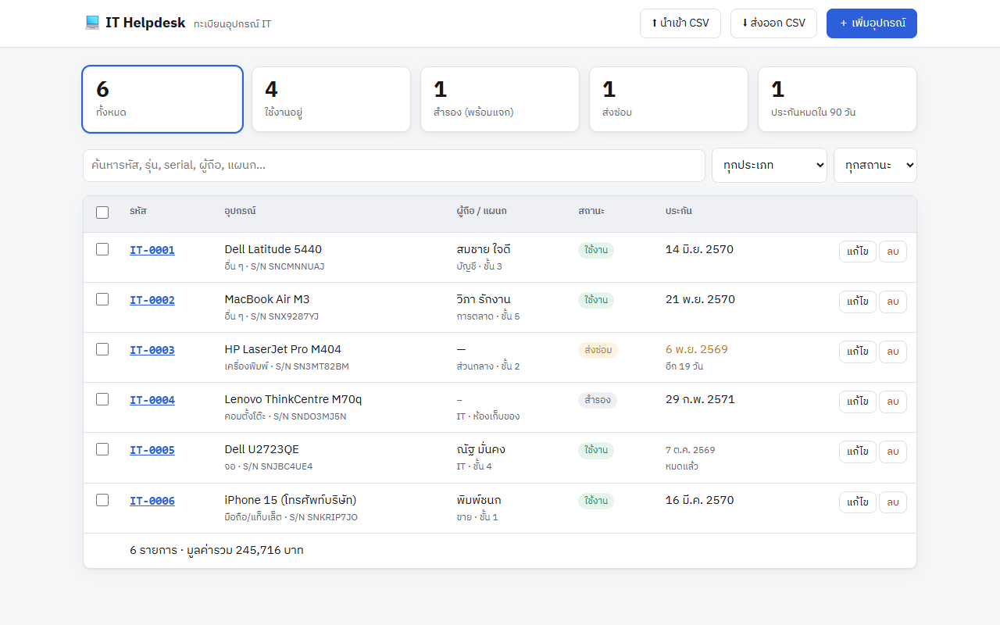
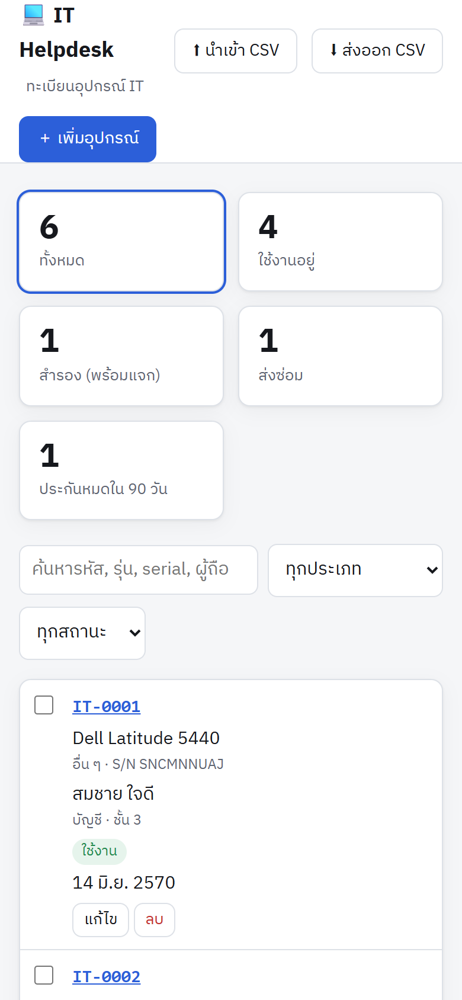

<div align="center">


<br>

   

</div>

<table>
<tr>
<td width="72%"></td>
<td width="28%"></td>
</tr>
<tr><td align="center"><sub>คอมพิวเตอร์ (ข้อมูลตัวอย่าง)</sub></td><td align="center"><sub>มือถือ</sub></td></tr>
</table>

ทะเบียนอุปกรณ์ IT แทนไฟล์ Excel ติด QR ไว้ที่เครื่อง สแกนแล้วรู้ทันทีว่าใครถือ อยู่ที่ไหน และประกันหมดเมื่อไหร่

## ความสามารถ
- **ทะเบียนอุปกรณ์**: รหัสทรัพย์สินสร้างอัตโนมัติ (IT-0001, IT-0002, …) พร้อม serial, ผู้ถือ, แผนก, สถานที่, ราคา และวันประกันหมด
- **ป้าย QR**: เลือกอุปกรณ์แล้วกด “พิมพ์ป้าย QR” จะได้หน้าป้ายขนาด 62×30 มม. พิมพ์บนสติกเกอร์ A4 ได้เลย
- **สแกน QR**:
  - คนทั่วไปเห็นข้อมูลย่อ พร้อมปุ่ม “แจ้งปัญหาเครื่องนี้”
  - แอดมินเห็นข้อมูลเต็มและประวัติ มีปุ่มลัด ส่งมอบ / รับคืน / ส่งซ่อม ใช้ตอนเดินตรวจหน้างานได้
- **ประวัติอัตโนมัติ**: บันทึกเองทุกครั้งที่เปลี่ยนผู้ถือ, สถานะ หรือสถานที่
- **นำเข้า/ส่งออก CSV**: ย้ายข้อมูลจาก Excel มาได้ทีเดียว (รองรับหัวคอลัมน์ภาษาไทย)
- **สรุปบนหน้าแรก**: จำนวนเครื่องที่ใช้งาน / สำรอง / ส่งซ่อม / ประกันใกล้หมด และมูลค่ารวม

## รันในเครื่อง
```bash
npm install
cp .env.example .env
npm run dev            # http://localhost:3000
```

## Deploy ขึ้น Vercel
1. Push ขึ้น GitHub แล้ว Import เข้า Vercel
2. Storage → เพิ่ม **Upstash Redis** (ฟรี)
3. ตั้ง `ADMIN_KEY` (จำเป็น), `ORG_NAME` และ `TICKET_URL`
4. พิมพ์ป้าย QR **หลัง deploy แล้ว** เพราะ QR จะชี้ไปที่โดเมนที่ใช้เปิดหน้าพิมพ์

> ใช้ร่วมกับ [it-expiry-alert](../it-expiry-alert) ได้ เช่นเอาวันประกันหมดของเครื่องสำคัญไปตั้งแจ้งเตือน

---

<div align="center"><sub>ชุดเครื่องมือ IT เดียวกัน: [🛠️ IT Runbook](https://github.com/tanakrthum254614-max/it-runbook) · [⏰ IT Expiry Alert](https://github.com/tanakrthum254614-max/it-expiry-alert) · โดย <a href="https://github.com/tanakrthum254614-max">tanakrthum254614-max</a> 🇹🇭</sub></div>
